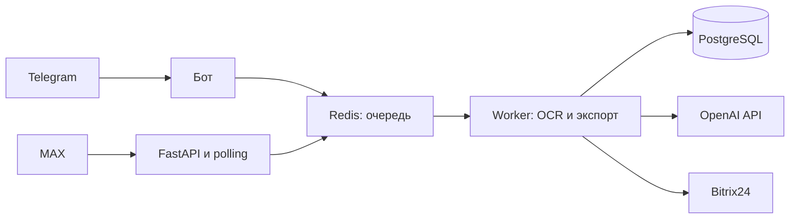
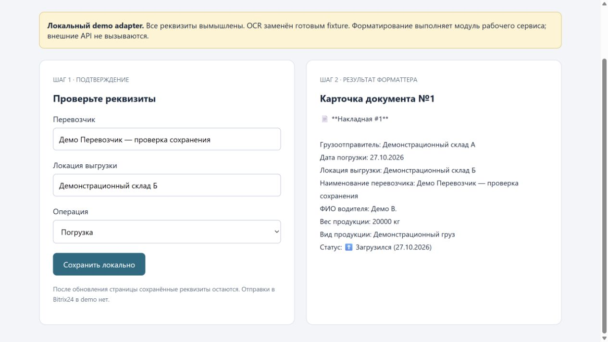

# Обработка транспортных накладных

Сервис для приёма фотографий накладных через Telegram и MAX, распознавания реквизитов и передачи подтверждённых данных в Bitrix24.

## Возможности

- Приём нескольких изображений и фоновая обработка очереди.
- Распознавание документов с помощью OpenAI API и отбор изображений по качеству.
- Подтверждение и исправление перевозчика, адреса выгрузки и других реквизитов.
- История операций: погрузка, выгрузка, заправка и слив.
- Отправка подтверждённого документа в Bitrix24.
- Отдельная обработка кнопок MAX с ограничением числа параллельных обработчиков.

## Архитектура



Код разделён на три сервиса в `tn-service/services`: `api`, `bot` и `worker`. PostgreSQL хранит документы и результаты распознавания; Redis передаёт задания между сервисами.

**Стек:** Python, FastAPI, python-telegram-bot, PostgreSQL, Redis, Docker Compose, OpenAI API, Bitrix24 REST API.

## Сценарий использования

1. Водитель отправляет фотографии накладной в бот.
2. Worker распознаёт реквизиты и возвращает карточку документа.
3. Пользователь исправляет поля, указывает статус операции и подтверждает результат.
4. Сервис передаёт данные в Bitrix24.

## Локальный запуск

Требуются Docker Compose и собственные учётные данные для внешних сервисов. Пустые значения в примере конфигурации не обеспечивают рабочий вход в Telegram, MAX или Bitrix24.

```sh
cd tn-service
cp .env.example .env
# Заполните .env своими значениями.
docker compose up --build
```

API использует TLS. Перед запуском поместите свой сертификат `cert.pem` и приватный ключ `key.pem` в `tn-service/local-certs/`. Compose подключает их только для чтения; ключ не включается в образ. Сертификат должен соответствовать адресу сервиса и быть доверенным для ваших клиентов.

Параметры конфигурации перечислены в `.env.example`. Локальная БД Compose использует демонстрационные реквизиты; перед размещением на сервере замените их и ограничьте сетевой доступ.

## Ограничения

Это интеграционный проект: для сквозного сценария нужны внешние API. OCR может ошибаться, поэтому перед экспортом предусмотрено подтверждение пользователем. Текущая версия не гарантирует защиту от повторного экспорта и совместимость со старыми кнопками MAX. Данные накладных и полные входящие сообщения могут попадать в диагностические логи; используйте вымышленные документы для демонстрации.

В репозитории нет лицензии, разрешающей свободное распространение. Возможность посмотреть исходники сама по себе не задаёт условия их использования.

## Демонстрация без внешних аккаунтов

```sh
python demo/server.py
# Откройте http://127.0.0.1:8761
python -m unittest discover -s tests -v
```

Demo использует вымышленный OCR fixture и настоящий formatter сервиса. Правки сохраняются в локальный JSON, внешние API не вызываются. Это демонстрация проверки документа, а не сквозной работы MAX/OCR/Bitrix.

## Проверка и реальный экран

[Результаты и ограничения проверки](docs/verification.md). Скриншот получен при локальном запуске на вымышленных данных.


